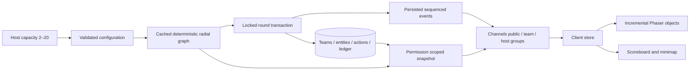

# Shared arena architecture

The server owns teams, membership, question/reward state, balances, legal slots, routes, combat and results. Phaser projects that state and plays persisted combat events. The minimap draws the same projected graph and never simulates combat.

Geometry scales by `max(1, team_count / 5)`. This keeps the old 2–5-team coordinates and provides space for 20 bases and 60 defensive slots. SMALL/MEDIUM/LARGE are descriptive metadata for counts ≤5 / ≤12 / ≤20; dimensions are calculated continuously rather than jumping between disconnected maps. Every branch connects to the same ring and hub. Symmetric reachability and cyclic distributions of shortest-path lengths are tested for all 19 supported counts.

Stable identity is the match's `(created_at, id)` team order. It persists through elimination. Node IDs and graph edges are compatible with existing matches. Pixel distance is presentation only: movement and range still use the original hop graph, so no unit stat, coin cost or scoring weight changes.

Snapshot reads batch entity counts, memberships and unlocks. Combat writes use ID dictionaries and bulk updates/inserts. Expected-round requests run inside the match lock; replay returns the persisted result without charging or paying again. SQLite retries restart the whole transaction; production Postgres uses row locks. Calls to the service without an expected round retain their legacy “resolve next round” meaning.

Phaser retains bases and entity containers by UUID. The terrain canvas's largest dimension is capped at 2048 pixels and stretched into world space; this bounds ground RGBA texture memory. Visibility and detail are updated at 10 Hz. Offscreen animations pause, overview troops become stack counts, HP bars hide at low zoom, and only 30 individual units per occupied node are shown when zoomed in. All units remain in authoritative state. Combat effects reuse pools (16 projectiles, 24 damage labels, 12 puffs); the scene always reconciles final server state after playback or skip. The minimap receives camera state at 10 Hz inside its own component, avoiding a React battle-page render per frame.

The central junction remains a deliberate choke point from the original game. Stack badges and bounded effects address graphical congestion; changing central collision or movement rules would change balance and is outside this expansion.
