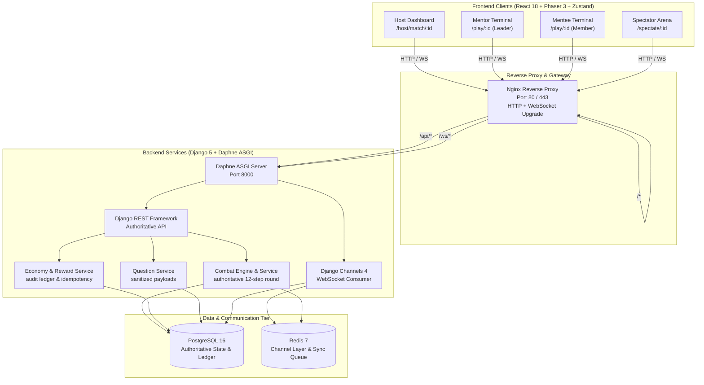
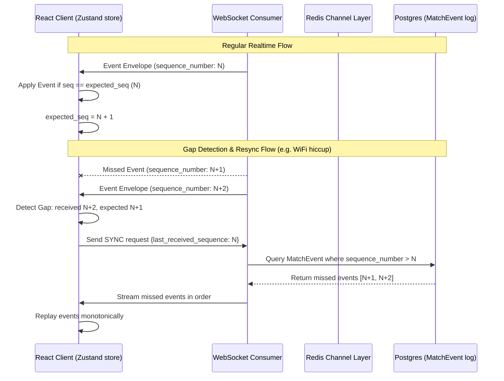
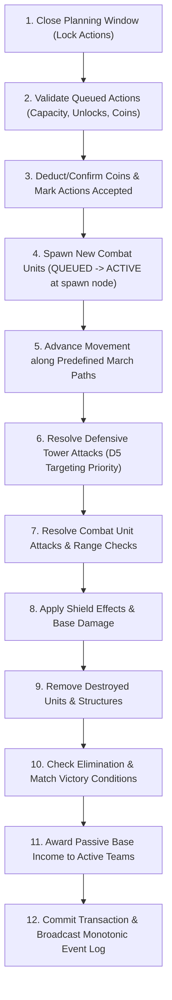

# Tower Defense — Architecture & System Design Guide

> Source: `GDD_PRD.md` §1–4, §19, Architectural Decisions D1–D14.

---

## 1. High-Level System Architecture

The game follows a **server-authoritative multiplayer architecture**. All game logic (combat calculations, movement, scoring, coin economy, and victory evaluation) executes strictly on the backend. The frontend clients (Mentor, Mentee, Host, Spectator) act as thin presentation layers powered by React and Phaser 3.



---

## 2. Realtime Event Delivery & Monotonic Sequence Numbering

To guarantee deterministic client rendering and seamless reconnection without state corruption, all realtime events follow a strictly **monotonic sequence number** per match.

### 2.1 Event Sequence Protocol



### 2.2 Event Envelope Structure

Every message broadcast over WebSocket or retrieved via the event replay REST API conforms to the standard envelope:

```json
{
  "event_id": "c1f7a049-74d6-4e50-93dc-8e5fbb77f101",
  "match_id": "dae220db-742d-49d7-b8ee-3207b66af63f",
  "sequence_number": 42,
  "timestamp": "2026-10-16T08:30:00.123456Z",
  "event_type": "COMBAT_RESOLVED",
  "is_private": false,
  "team_id": null,
  "payload": {
    "round_number": 3,
    "events": [
      {
        "type": "TOWER_ATTACKED",
        "tower_id": "tow_1",
        "target_entity_id": "u_2",
        "damage": 25
      }
    ],
    "eliminated_teams": [],
    "winner_team_id": null,
    "is_match_over": false
  }
}
```

---

## 3. Authoritative Combat Round Lifecycle (12-Step Pipeline)

Combat rounds execute periodically (default every 30s) or on manual Host trigger. The execution follows the authoritative 12-step sequence defined in `GDD_PRD.md` §10.1:



---

## 4. Security & Hardening Boundaries

1. **Answer Masking:** Questions sent to participants (`/questions/current/`, `/questions/all/`) omit `answer_key`, `explanation`, and `answer_validator_type`. Correct answers are never exposed to the browser.
2. **Double-Spend & Race Protection:** All coin operations use `select_for_update()` inside database transactions, with immutable ledger audit entries in `CoinTransaction`.
3. **Action Authorization:** Every action endpoint verifies participant role (Mentors only for special actions, Spectators blocked from state changes) and checks that the team belongs to the authenticated token.
4. **Graceful Degradation:** If Redis becomes temporarily unavailable, the system logs a controlled warning and falls back to HTTP snapshot polling, preventing crash loops.
